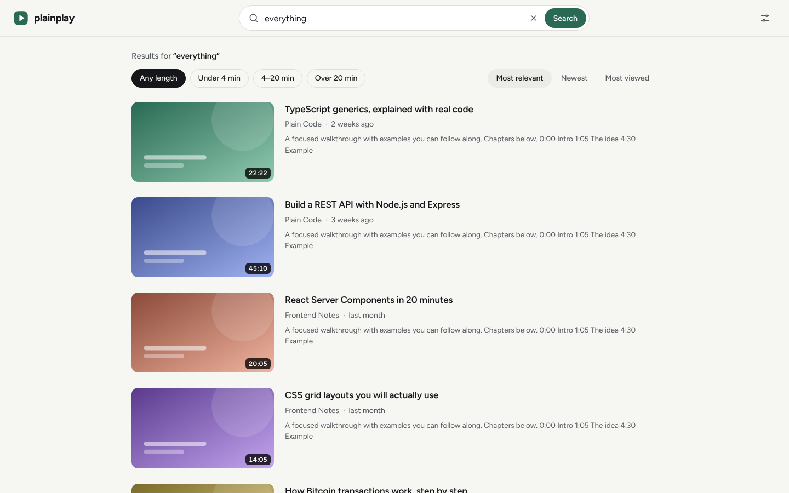
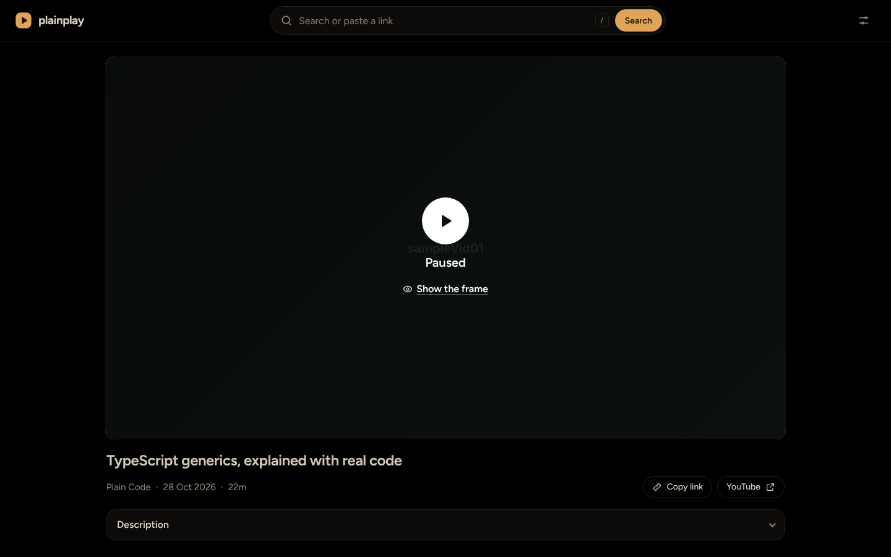
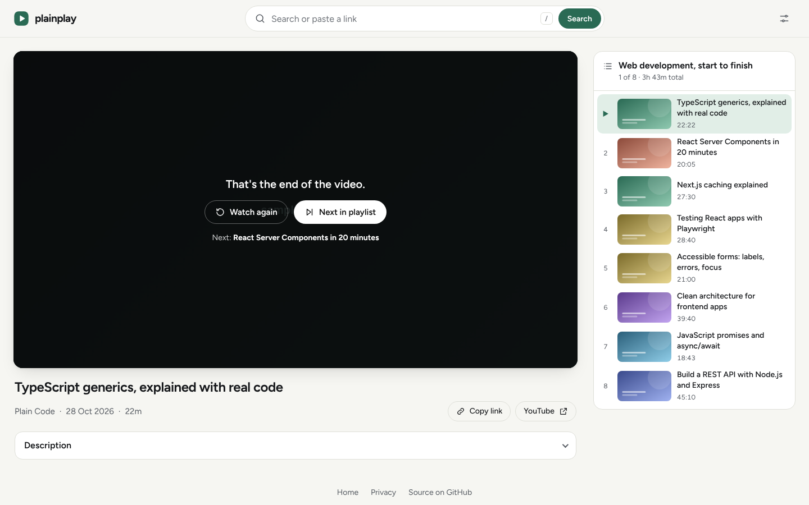
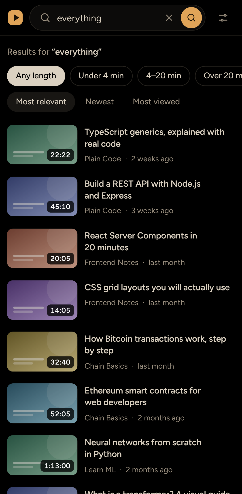
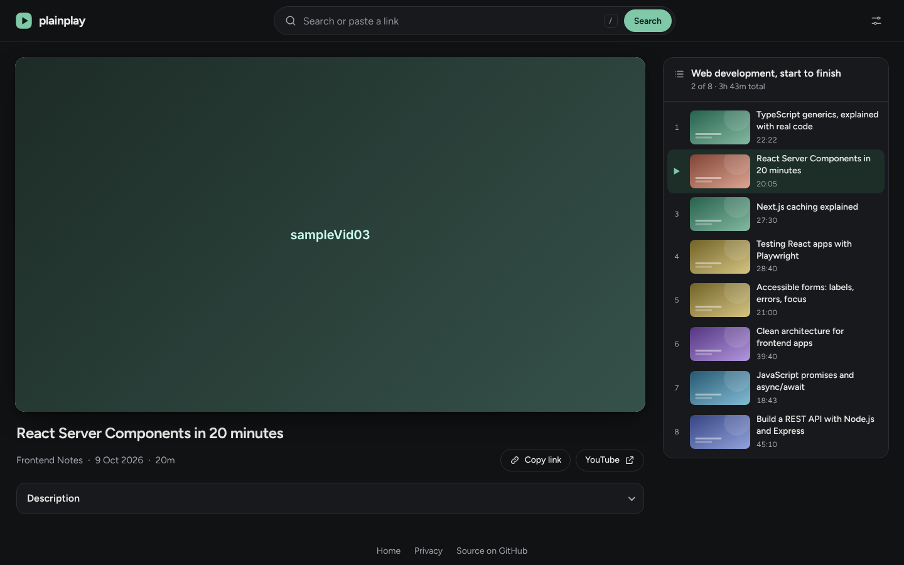
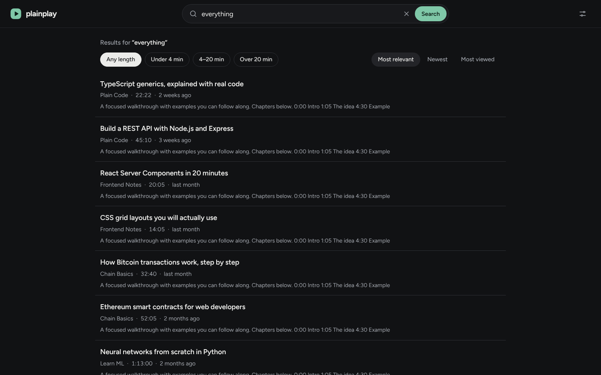
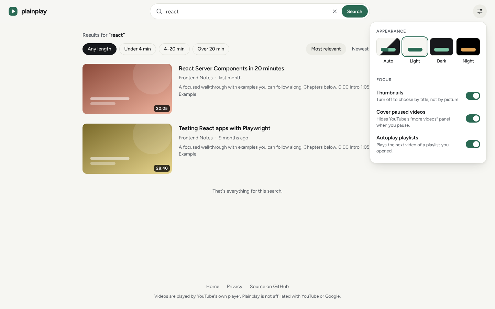

# Plainplay

**YouTube without the rabbit hole.** Search for a video, watch it, and leave. Plainplay has no home feed, no recommended videos, no comments and no Shorts shelf.

**Live demo:** https://plainplay.vercel.app



## Why

YouTube is a great library with a slot machine bolted on. You open it to watch one tutorial and leave an hour later. Plainplay keeps the library and removes the slot machine.

## What it does

- **Search and watch, nothing else.** The home page is a single search box. Results show title, channel, length and age, and nothing is ranked "for you".
- **Hides YouTube's own suggestions.** Videos play in YouTube's privacy-enhanced player with related videos and annotations turned off. When you pause, Plainplay covers the "More videos" panel. When a video ends, it covers the end-screen grid.
- **Paste any link.** Video, `youtu.be`, Shorts, embed, live and playlist links open straight away, including the start time (`?t=1m30s`). YouTube Mixes are skipped because they are recommendations.
- **Playlists for courses.** A playlist link shows only that playlist, with progress ("3 of 24 · 6h 10m total") and an optional autoplay to the next video. You can cancel the autoplay or turn it off.
- **Picks up where you left off.** Your place in each video is saved in your browser.
- **Clickable chapters.** Timestamps in a video's description jump the player.
- **Light, dark and night themes.** Night is true black with warm, low-glare text for late sessions. "Auto" follows your device, and there's no flash of the wrong theme on load.
- **Text-only mode.** Turn thumbnails off and choose videos by title instead of by picture.
- **Filters that help you focus:** length (under 4, 4–20, over 20 minutes) and sort (relevance, newest, most viewed).

| Night theme, paused | End of a playlist video | Mobile |
| --- | --- | --- |
|  |  |  |

| Playlist (dark) | Text-only results | Settings |
| --- | --- | --- |
|  |  |  |

## Tech stack

- **Next.js 16** (App Router, Cache Components, Partial Prerendering) with **React 19** and **TypeScript** (strict)
- **YouTube Data API v3**, called only from the server so the API key never reaches the browser
- **YouTube IFrame Player API** through `youtube-nocookie.com`
- Hand-written CSS with design tokens for the three themes (no UI framework), self-hosted Figtree font
- **Vitest** for unit tests, **Playwright** + **axe-core** for browser and accessibility tests
- **GitHub Actions** CI, deployable on **Vercel** or with **Docker**

## How it works

```
Browser ──► Next.js server ──► YouTube Data API (search, video details, playlists)
   │             │
   │             └─ cached for an hour ("use cache: remote"), rate-limited per visitor
   │
   └──► YouTube player (youtube-nocookie.com), wrapped in Plainplay's own overlays
```

- **Saving quota.** A YouTube search costs 100 of the 10,000 daily quota units, so search results are cached for about an hour and limited to 30 searches per visitor every 10 minutes. Video details cost 1 unit. If the API is down or out of quota, a video still plays: details fall back to YouTube's oEmbed endpoint, which needs no quota.
- **Clear errors.** Quota exhaustion, a missing key, private or deleted videos, videos that can't be embedded and a blocked player script each get their own message and next step.
- **Loaders everywhere.** Skeleton results and a skeleton player while pages stream in, a thin progress bar on every navigation, a spinner until the player is ready, and a busy state on "Load more".
- **Security.** Strict Content-Security-Policy (only YouTube's player can be framed), `X-Frame-Options: DENY`, HSTS, no `X-Powered-By`, and safe links (`noopener noreferrer nofollow ugc`) in descriptions.
- **Accessibility.** Keyboard shortcut `/` to search, skip link, visible focus rings, screen-reader labels for durations, `prefers-reduced-motion` support, and axe checks in all three themes.

## Run it locally

Requirements: Node.js 20.9 or newer.

```bash
git clone https://github.com/Shahryartariq/plainplay.git
cd plainplay
npm install
cp .env.example .env.local   # add your YOUTUBE_API_KEY
npm run dev                  # http://localhost:3000
```

Without a key, development uses built-in sample data, so you can try the whole interface straight away.

### Environment variables

| Name | Required | What it does |
| --- | --- | --- |
| `YOUTUBE_API_KEY` | Yes, in production | YouTube Data API v3 key. Restrict it to that API; don't add a website restriction, because only the server uses it. |
| `SITE_URL` | Recommended | Public address, used for the sitemap and social previews. |
| `SEARCH_RATE_LIMIT` | No | Searches per visitor every 10 minutes (default 30). |
| `PLAINPLAY_SAMPLE_DATA` | No | `1` uses sample data instead of YouTube (used by the tests). |

### Scripts

| Command | What it does |
| --- | --- |
| `npm run dev` | Start the dev server |
| `npm run build` / `npm start` | Production build and server |
| `npm run lint` / `npm run typecheck` | ESLint and TypeScript |
| `npm test` | 60 unit tests (link parsing, durations, API mapping, quota and error handling) |
| `npm run test:e2e` | 34 browser tests × desktop and mobile, with axe accessibility checks |
| `node scripts/screenshots.mjs` | Re-render the README screenshots (server running on port 3100) |

The browser tests replace YouTube's player with a small fake, so they run offline and can pause, end or break the player on demand.

## Deploy

**Vercel:** import the repo, add `YOUTUBE_API_KEY` and `SITE_URL`, and deploy. No other setup is needed.

**Docker:**

```bash
docker build -t plainplay .
docker run -p 3000:3000 -e YOUTUBE_API_KEY=your-key plainplay
```

## Limits

- YouTube's player is an iframe, so a few things inside it are out of reach. Creator "end screen" cards in the last seconds of a video, and the video's own title bar, are drawn by YouTube.
- Channel pages aren't supported. Browsing a channel is where the rabbit hole starts.
- Playlists longer than 500 videos show the first 500.

## Privacy

No accounts, analytics or ads. Settings and watch positions stay in your browser. Read the [privacy page](https://plainplay.vercel.app/privacy).

---

Built by [Muhammad Shehryar](https://github.com/Shahryartariq). Plainplay is not affiliated with YouTube or Google.
